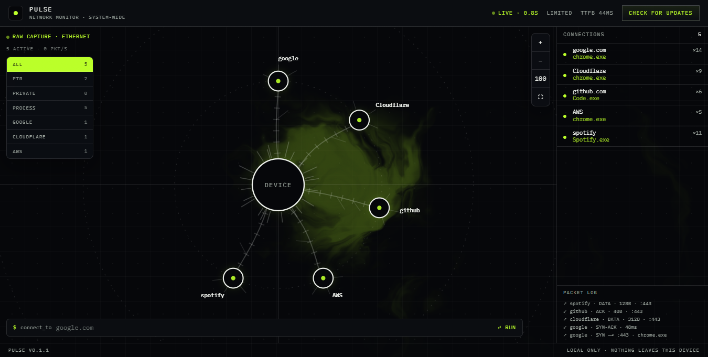
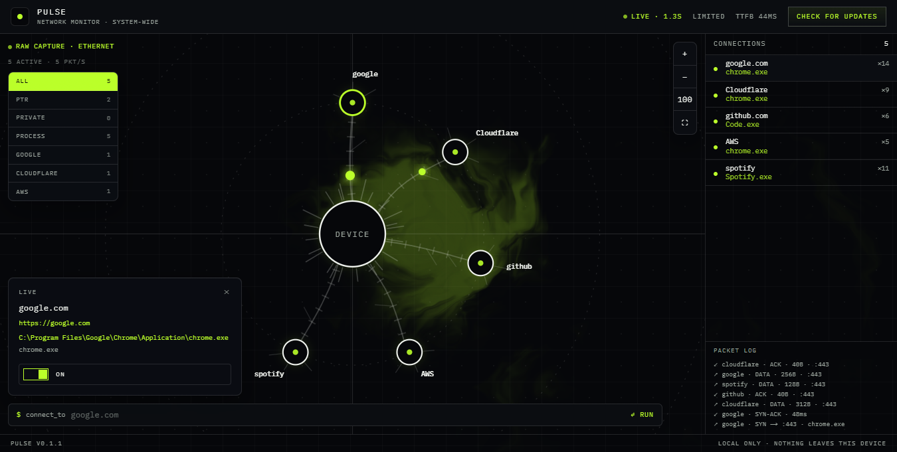
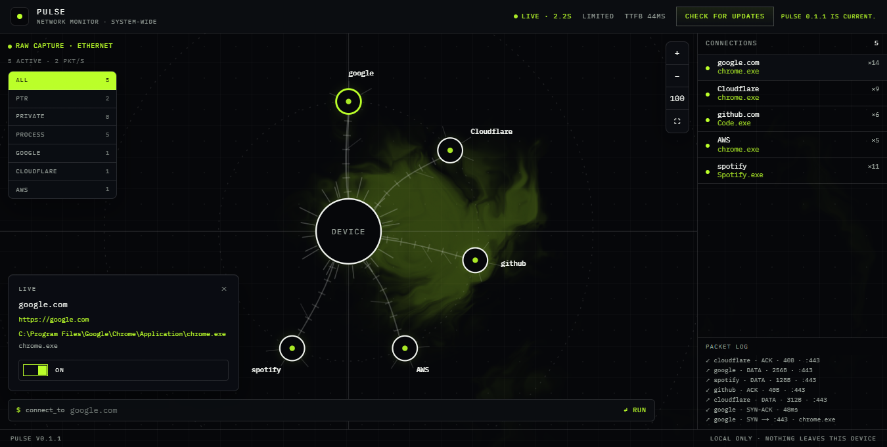
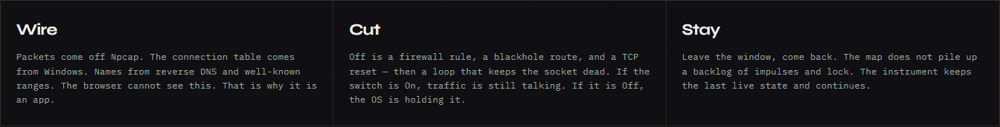
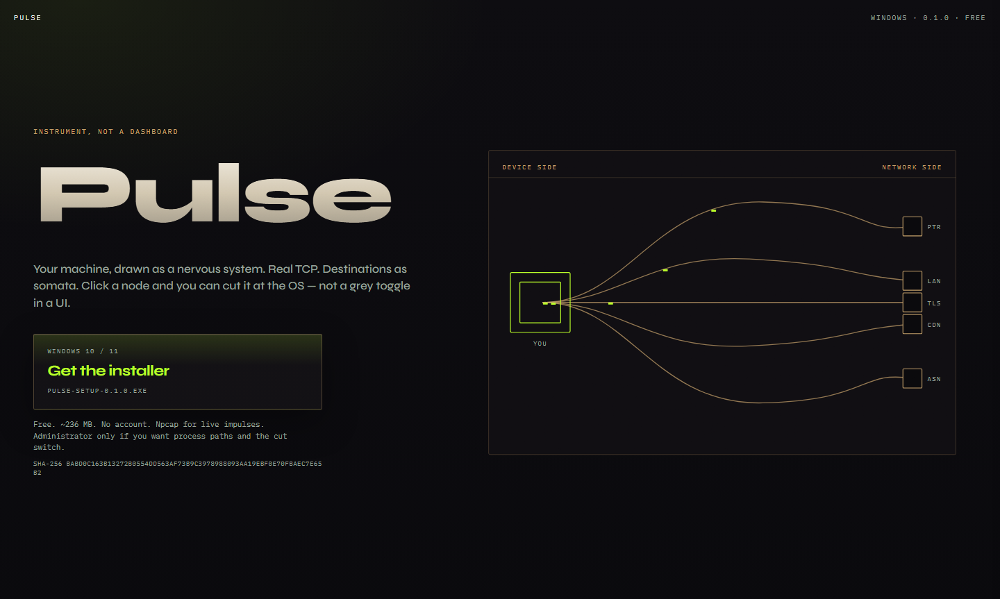
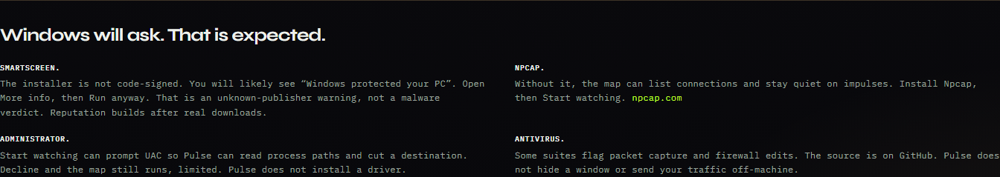
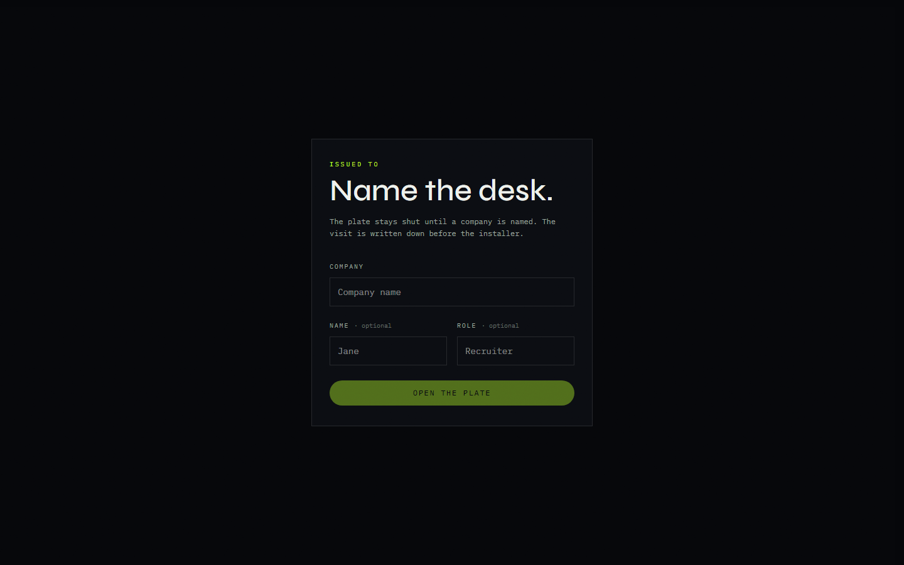

# Pulse

Your Windows machine, drawn as a nervous system.

Task Manager will give you a list. Pulse gives you the shape. You sit in the middle. Every destination takes a seat and keeps it. Real packets travel the wires — not a screensaver pretending to be traffic.

[Live site](https://pulse-beryl-one.vercel.app) · [Installer](https://github.com/spookyambassador98/pulse/releases/latest/download/Pulse-Setup-0.1.1.exe) · [MIT](LICENSE)







## Why it exists

A browser tab cannot see the machine. The connection table belongs to Windows.

I got tired of staring at IP addresses and still having no idea who the laptop was talking to. Chrome looks quiet. The map does not. Google, Cloudflare, a couple of AWS boxes, Spotify on its own little planet — all of it is already happening. Pulse just turns the lights on.

Click a node and you can read who it is, which process owns it, and the path on disk. If you want the talking to stop, Off is not a grey toggle in a window. With administrator, Off is a firewall rule, a blackhole route, and a TCP reset — then a loop that keeps the socket dead.

Leave the window. Come back. The map does not pile up a backlog and lock. It keeps the last live state and continues.

## Two surfaces

The website is the plate you download from. The app is the map.

The plate can show you the idea. Only the installed app can see every established connection on the machine, listen for live impulses (if Npcap is there), and cut a destination at the OS.

That is why the map is not a web demo.





## Install on Windows

1. Download [Pulse-Setup-0.1.1.exe](https://github.com/spookyambassador98/pulse/releases/latest/download/Pulse-Setup-0.1.1.exe). Free. About 179 MB. No account.
2. SmartScreen will likely say “Windows protected your PC”. The installer is not code-signed. Open **More info**, then **Run anyway**. That is an unknown publisher, not a malware verdict.
3. Install [Npcap](https://npcap.com/#download) if you want live impulses on the wires. Without it, the map can still list connections and stay quiet on the wire.
4. Open Pulse and choose **Start watching**. Windows may ask for administrator. Accept if you want process paths and the cut. Decline and the map still runs, limited. Pulse does not install a driver.
5. Check the file if you want to. SHA-256 `a7862737be174f6bfd0a494904655d4757f967be5b4c5fdd0fe2a4319fcad8c5`.



Some antivirus suites flag packet capture and firewall edits. The source is this repository.

## Use the map

**Start watching** reads the Windows connection table. The device sits in the center. Destinations fan out and keep the seat they were given, so a socket that blinks does not make the whole map jitter.

- Drag to pan. Scroll to zoom toward the cursor. Double-click, or the percentage button, to reset the view.
- Filters along the top: All, PTR, Private, Process, Google, Cloudflare, AWS.
- Click a node. You get the name, the address, the process, and the path. **Cut** holds that destination at the OS. Turning it back removes the rule and the route.
- The field at the bottom can point Pulse at any host. That opens a real TCP handshake. A failure stays a failure. Pulse does not paint a success it did not get.
- **Check for updates** lives in the app header. It asks GitHub for a newer `Pulse-Setup` installer, downloads that file, and runs it. It does not update the website.

## Build it

Windows is the app. The site can be built anywhere Node runs.

```bash
npm install
npm run dev          # the plate, at localhost:3000
npm run electron     # build the site, then open the desktop window
npm run dist:win     # Pulse-Setup-<version>.exe
```

`npm run electron` needs a Windows machine with this repo. Live impulses need Npcap, then a rebuild of the optional `cap` module (`npm run rebuild-native`) if you want raw capture inside the shell. The connection table itself does not need Npcap and does not need a driver from Pulse.

The native module is optional on purpose. A host that only builds the website, including Vercel, has no libpcap headers, and the site does not need them.

The package is marked private so `npm publish` will not take it. The source is MIT. Install it from GitHub, or build the installer.

## What is inside

```
src/                 Next.js, React, TypeScript
  components/        plate, gate, and the neuron map
  lib/pulse/         layout, categories, the desktop bridge
electron/            the window, the connection table, Npcap, the cut
resources/           icon and the installer notice
docs/screenshots/    the photographs in this file
```

The site and the window are the same Next.js app. `electron/main.js` serves that build on `127.0.0.1`, polls the OS connection table, and, when Npcap is present, listens for packets. In a normal browser tab the desktop bridge is absent, so you get the plate instead of the map.

Slots are assigned once per destination and not recycled during the session. A socket that drops and returns does not jump to a new seat.

## What it will not pretend

- The installer is unsigned. SmartScreen will say so until the file has a reputation.
- Pulse does not ship its own kernel driver. Npcap is a separate install, and it is optional.
- Administrator is optional. Without it you do not get process paths, and you cannot cut a destination.
- The map does not upload packet payloads. The plate can report a visit. Those are different machines with different jobs.
- This is an instrument for a machine you own. Cutting a node changes the firewall and the route table on that machine.

The public site stays shut until a company is named. Name and role are optional. Packet bytes from the desktop map stay on the machine.



| Variable | What it does |
| --- | --- |
| `NEXT_PUBLIC_DOWNLOAD_URL` | Where `/download` sends the browser. Default is the GitHub release. |
| `NEXT_PUBLIC_VISITS_URL` | Where the plate reports a visit. |
| `SALONTECH_DOWNLOADS_URL` | Where `/download` reports a download. |
| `DOWNLOADS_SECRET` | Optional header on that download report. Never commit it. |

## License

[MIT](LICENSE). Copyright © 2026 Pulse contributors.
