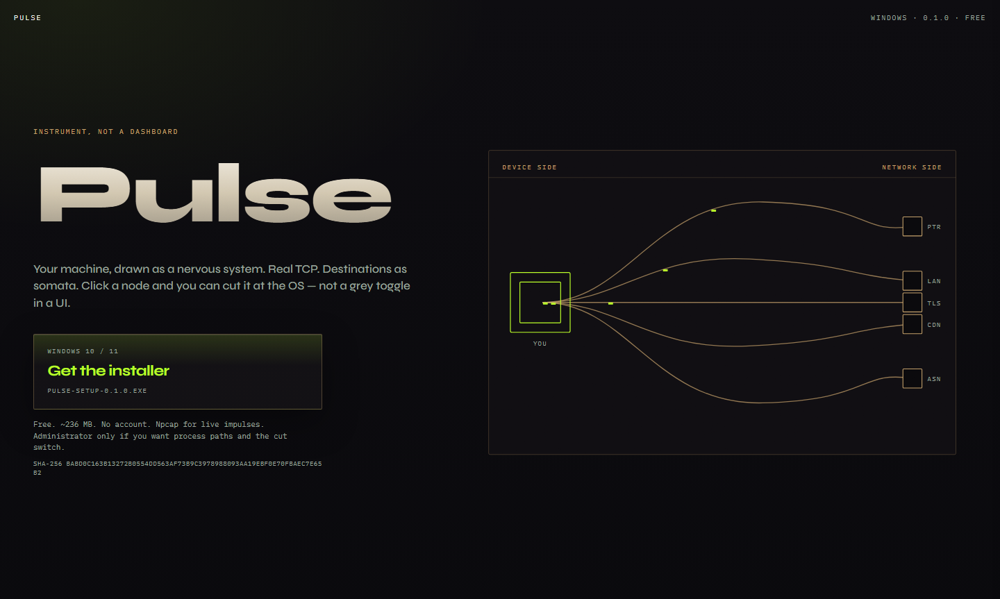
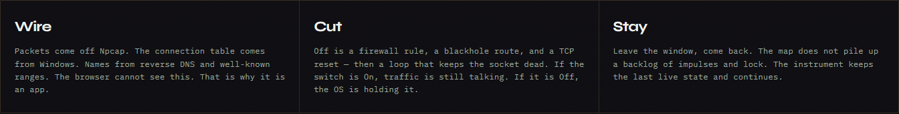
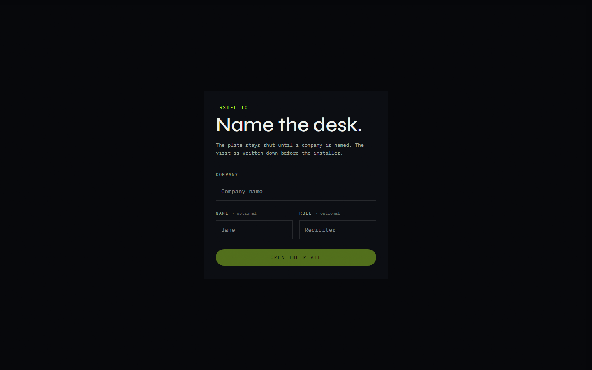
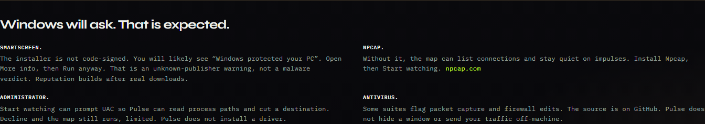
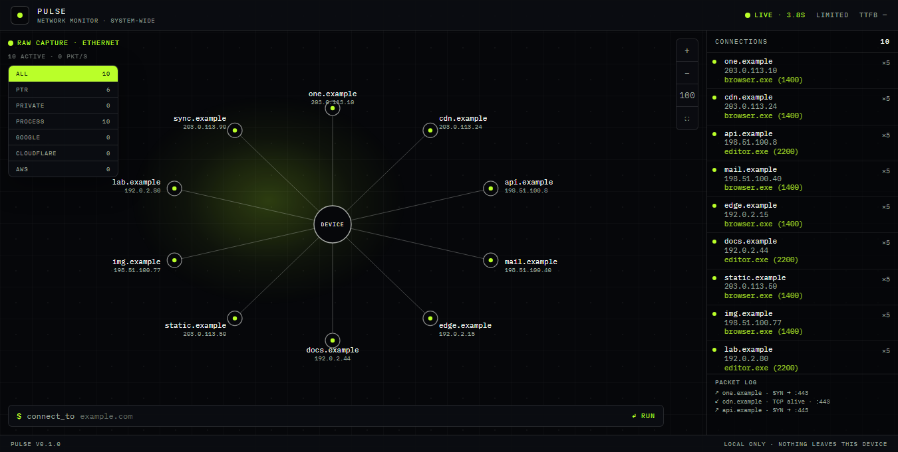

# Pulse

A free Windows instrument. This machine, drawn as a nervous system.

The website is the download plate. The app is the map. Real TCP, destinations as somata, and a cut that the operating system holds — not a grey toggle in a window.

Live: [pulse-beryl-one.vercel.app](https://pulse-beryl-one.vercel.app) · Installer: [Pulse-Setup-0.1.0.exe](https://github.com/spookyambassador98/pulse/releases/latest/download/Pulse-Setup-0.1.0.exe) · License: [MIT](LICENSE)



## Why it exists

A browser tab cannot see the machine. The connection table belongs to Windows. Task Manager will give you a list. Pulse gives you the shape.

You sit in the center. Each destination takes a seat and keeps it for the session, so the map does not jitter every time a socket blinks. Impulses travel the axon between you and that seat. Names come from reverse DNS and from ranges that are already well known. Click a node and you can read who it is, which process owns it, and the path on disk.

Off is not a drawing. With administrator, Off is a firewall rule, a blackhole route, and a TCP reset, then a loop that keeps the socket dead. If the switch is On, traffic is still talking. If it is Off, the OS is holding it.

Leave the window and come back. The map does not pile up a backlog of impulses and lock. It keeps the last live state and continues.

## Two surfaces

| | Website | Installed app |
| --- | --- | --- |
| What it is | The plate you download from | The map |
| What it can see | This tab | Every established connection on the machine |
| Impulses | The etched board on the page | Npcap, when it is installed |
| Cut | No | Yes, and only with administrator |

The browser cannot see the connection table. That is why the map is an app.



## Open the plate

The public site stays shut until a company is named. Name and role are optional. The visit is written down before the installer.



The site can post the visit and the download to a URL you set. The desktop map does not. Packet bytes stay on the machine. Pulse does not hide a window, and it does not ship your traffic off-box.

| Variable | What it does |
| --- | --- |
| `NEXT_PUBLIC_DOWNLOAD_URL` | Where `/download` sends the browser. Default is the GitHub release. |
| `NEXT_PUBLIC_VISITS_URL` | Where the plate reports a visit. |
| `SALONTECH_DOWNLOADS_URL` | Where `/download` reports a download. |
| `DOWNLOADS_SECRET` | Optional header on that download report. Never commit it. |

## Install on Windows

1. Download [Pulse-Setup-0.1.0.exe](https://github.com/spookyambassador98/pulse/releases/latest/download/Pulse-Setup-0.1.0.exe). Free. About 236 MB. No account.
2. SmartScreen will likely say “Windows protected your PC”. The installer is not code-signed. Open **More info**, then **Run anyway**. That is an unknown publisher, not a malware verdict.
3. Install [Npcap](https://npcap.com/#download) if you want live impulses. Without it, the map can still list connections and stay quiet on the wire.
4. Open Pulse and choose **Start watching**. Windows may ask for administrator. Accept if you want process paths and the cut. Decline and the map still runs, limited. Pulse does not install a driver.
5. Check the file if you want to. SHA-256 `babd0c163b13272b0554dd563af73b9c3978988093aa19ebf0e70fbaec7e65b2`.



Some antivirus suites flag packet capture and firewall edits. The source is this repository.

## Use the map

**Start watching** reads the Windows connection table. The device sits in the center. Destinations fan out and keep the seat they were given.

- Drag the field to pan. The wheel zooms toward the cursor. Double-click, or the percentage button, resets the view.
- Filters along the top: All, PTR, Private, Process, Google, Cloudflare, AWS.
- Click a node. You get the name, the address, the process, and the path. **Cut** holds that destination at the OS. Turning it back removes the rule and the route.
- The field at the bottom can point Pulse at any host. That opens a real TCP handshake. A failure stays a failure. Pulse does not paint a success it did not get.
- Fullscreen is the square button. Escape leaves it.

The photograph below is the installed app on a real machine, after **Start watching**, not a mock of the layout.



## Build it

Windows is the app. The site can be built anywhere Node runs.

```bash
npm install
npm run dev          # the plate, at localhost:3000
npm run electron     # build the site, then open the desktop window
npm run dist:win     # Pulse-Setup-<version>.exe
```

`npm run electron` needs a Windows machine with this repo. Live impulses need Npcap, then a rebuild of the optional `cap` module (`npm run rebuild-native`) if you want raw capture inside the shell. The connection table itself does not need Npcap and does not need a driver from Pulse.

The native module is optional on purpose. A host that only builds the website, including Vercel, has no libpcap headers, and the site does not need them.

The package is marked private so `npm publish` will not take it. The source is MIT. Install it from GitHub, or build the installer.

## What is inside

```
src/                 Next.js 16, React 19, TypeScript
  components/        plate, gate, and the neuron map
  lib/pulse/         layout, categories, the desktop bridge
electron/            the window, the connection table, Npcap, the cut
resources/           icon and the installer notice
docs/screenshots/    the photographs in this file
```

The site and the window are the same Next.js app. `electron/main.js` serves that build on `127.0.0.1`, polls the OS connection table through `systeminformation`, and, when Npcap is present, listens for packets. The renderer talks to that process through a small preload bridge, `window.pulseDesktop`. In a normal browser tab the bridge is absent, so you get the plate instead of the map.

GSAP moves the impulses along the axons. Slots are assigned once per destination and not recycled during the session, so a socket that drops and returns does not jump to a new seat.

## What it will not pretend

- The installer is unsigned. SmartScreen will say so until the file has a reputation.
- Pulse does not ship its own kernel driver. Npcap is a separate install, and it is optional.
- Administrator is optional. Without it you do not get process paths, and you cannot cut a destination.
- The map does not upload packet payloads. The plate can report a visit. Those are different machines with different jobs.
- This is an instrument for a machine you own. Cutting a node changes the firewall and the route table on that machine.

## License

[MIT](LICENSE). Copyright © 2026 Pulse contributors.

The work in this repository was written as a collaboration between Claude and Cursor.
